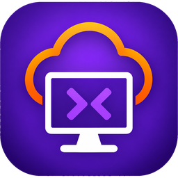

<p align="center">
  
</p>

<h1 align="center">Switchboard Remote Manager</h1>

<p align="center">
  Remote Desktop and SSH in tabs, to your AWS servers through Systems Manager and to any other machine directly.
  <br>
  A single self-contained Windows app: no AWS console, no open inbound ports, no VPN.
</p>

---

Switchboard RM lists your EC2 instances across the AWS regions you choose and opens each one in a tab, over a
hidden [AWS Systems Manager Session Manager](https://docs.aws.amazon.com/systems-manager/latest/userguide/session-manager.html)
tunnel. Windows servers open in Remote Desktop, Linux servers in an embedded SSH terminal. It also keeps your
ordinary RDP and SSH connections (or imports them from RDCMan, mRemoteNG, `.rdp` files and PuTTY) in the same place.

<!-- Screenshots: add a couple here, e.g.  -->

## Features

**Connecting**
- Remote Desktop and SSH sessions in tabs, side by side.
- AWS servers are reached through Session Manager port forwarding (3389 for RDP, 22 for SSH), so they need the SSM
  agent but no public IP, inbound security-group rules or bastion host.
- The remote desktop resizes with the window (dynamic resolution on Windows Server 2012 R2 and newer).
- Embedded SSH terminal: Windows' own OpenSSH client in a pseudo-console, shown with xterm.js. Your `~/.ssh` keys,
  the Windows SSH agent, `~/.ssh/config` and `known_hosts` work as usual. Host keys for AWS servers are remembered by
  instance ID, so the tunnel's changing local port never triggers host-key warnings.
- Linux servers default to SSH and Windows servers to RDP; Server > Connect with SSH / Remote Desktop overrides it.

- Terminals can be docked in a resizable panel under the tabs, next to a remote desktop.
- Local shells in tabs too: Command Prompt, Windows PowerShell, PowerShell 7, Git Bash and WSL (when installed),
  with `AWS_PROFILE` and the bundled AWS tools already set up.

**AWS servers**
- Lists every EC2 instance (except terminated ones) and anything else Systems Manager manages, across chosen regions.
- Live status: Online, Agent offline, Starting, Stopping, Stopped, Running without SSM.
- Start, stop and reboot instances from the toolbar, the Server menu or the right-click menu, with confirmation
  and live status tracking. Double-clicking a stopped server offers to start it and connects when it's ready.
- Filters: search, Windows only, Hide offline. Movable and hideable columns.

**Saved connections**
- Plain RDP or SSH connections to any machine, with optional groups, kept on their own tab.
- Reachability check on each refresh.
- Import from RDCMan (`.rdg`), Remote Desktop files (`.rdp`), mRemoteNG (`confCons.xml`) and PuTTY saved sessions.

**Sign-in**
- Microsoft Entra ID sign-in through [aws-azure-login](https://github.com/aws-azure-login/aws-azure-login), or AWS
  IAM Identity Center (SSO) profiles.
- Sign-in status with time remaining, optional background renewal ("Keep me signed in"), paused while Windows is
  locked or asleep.
- Asks Entra for each profile's own account (`login_hint`), so a separate admin account isn't swapped for the
  account signed in to Windows.
- Signs you in automatically when you connect while signed out; optionally signs out of AWS when the app closes,
  after ending all open sessions.
- Add and remove AWS profiles from the app.

**Everything else**
- RDP passwords saved in Windows Credential Manager (never in files).
- Customisable look: light, dark or match Windows; any accent colour (presets, the Windows accent or a custom
  colour); app font, server list text size, and terminal font and size.
- Extra fonts without installing them: put `.ttf` / `.otf` files in a `fonts` folder next to `SwitchboardRM.exe`
  (in the project: `fonts\`, copied on publish). They're offered in Settings > Appearance for the app and terminals.
- Splash screen, settings window, About page with bundled tool versions.
- Ships as one self-contained `.exe` plus a `tools\` folder: nothing to install on the target PC.

## Requirements

**To run the published app**
- Windows 10 or 11, x64.
- The Microsoft Edge WebView2 Runtime, for the SSH terminal only (included with Windows 10/11).
- The OpenSSH Client, for SSH only (Windows Settings > Apps > Optional features), unless bundled in `tools\openssh\`.
- Node.js, aws-azure-login, the Session Manager plugin and the AWS CLI: included in the release download, or
  installed yourself (see [Installation](#installation)).

**To build**
- The [.NET 10 SDK](https://dotnet.microsoft.com/download).
- Visual Studio 2022+ or VS Code, optional.

**On the AWS side**
- Instances with the SSM agent installed and registered (online in Fleet Manager).
- For SSH to AWS servers: an SSH server on the instance and a key or account to log in with.
- IAM permissions for the signed-in role:

| Permission | Used for |
|---|---|
| `ec2:DescribeInstances` | the server list |
| `ssm:DescribeInstanceInformation` | Systems Manager status |
| `ssm:StartSession` (on the instances and the `AWS-StartPortForwardingSession` document) | connecting |
| `ssm:TerminateSession` | ending sessions cleanly when a tab or the app closes |
| `ec2:StartInstances`, `ec2:StopInstances`, `ec2:RebootInstances` | optional: start / stop / reboot |

## Installation

There are two ways to get Switchboard running: download a release, which includes everything, or build it yourself
and install the helper tools it uses.

### Option A: download a release (helper tools included)

1. Download `SwitchboardRM-<version>.zip` from [Releases](../../releases) and extract it anywhere, for example
   `C:\Tools\SwitchboardRM`. Keep the `tools` folder next to `SwitchboardRM.exe`.
2. Run `SwitchboardRM.exe`. It isn't code-signed, so Windows SmartScreen may ask you to confirm the first time
   (**More info > Run anyway**).
3. Set up an AWS profile and sign in (see [First-time sign-in setup](#first-time-sign-in-setup)).

The release bundles Node.js, aws-azure-login, the Session Manager plugin and the AWS CLI in `tools\`, so nothing else
needs installing. What's included, with versions and licences, is listed in `tools\THIRD-PARTY-NOTICES.txt`.

### Option B: build it and install the helper tools yourself

**1. Build Switchboard**

```powershell
git clone <this repository>
cd SwitchboardRM
.\publish.cmd          # needs the .NET 10 SDK; the app lands in .\output
```

**2. Install the helper tools.** Switchboard finds installed copies on its own (on `PATH` or in their default folders).

| Tool | Needed for | How to install |
|---|---|---|
| AWS Session Manager plugin | every AWS connection | Install it with the Windows installer from AWS: [Install the Session Manager plugin](https://docs.aws.amazon.com/systems-manager/latest/userguide/install-plugin-windows.html). Check with `session-manager-plugin --version`. |
| Node.js (LTS) | Microsoft Entra sign-in | Install from [nodejs.org](https://nodejs.org). Then, in a **new** terminal, `npm install -g aws-azure-login` and check with `aws-azure-login --version`. Installing it also downloads a browser for Puppeteer into `%USERPROFILE%\.cache\puppeteer`. |
| AWS CLI v2 | IAM Identity Center (SSO) profiles only | Install with the Windows installer: [Install the AWS CLI](https://docs.aws.amazon.com/cli/latest/userguide/getting-started-install.html). |
| OpenSSH Client | SSH sessions only | Usually already present. If not: Windows Settings > System > Optional features > OpenSSH Client, or `Add-WindowsCapability -Online -Name OpenSSH.Client~~~~0.0.1.0` in an admin PowerShell. |
| WebView2 Runtime | SSH sessions only | Included with Windows 10/11. If missing, install the Evergreen runtime from Microsoft's WebView2 page. |

**3. Run** `output\SwitchboardRM.exe` and continue with the first-time sign-in setup below.

For development, open the folder in Visual Studio or VS Code and run it (`dotnet run`).

### First-time sign-in setup

Existing profiles in `~/.aws` are picked up automatically. To add one, use **Add profile** (bottom of the profile
list on the toolbar, Settings > AWS profile, or the AWS menu):

- **Microsoft sign-in (aws-azure-login)** opens a setup window that runs `aws-azure-login --configure`. Have these ready:

  | Question | Answer |
  |---|---|
  | Azure Tenant ID | your organisation's Microsoft Entra tenant ID (from your administrator; the window shows it if another profile on the PC already has one) |
  | Azure App ID URI | the AWS app's identifier in Entra, usually `urn:amazon:webservices` |
  | Default Username | the account to sign in with. Switchboard also asks Entra for this account, so a separate admin account isn't swapped for the one signed in to Windows. |
  | Default Role ARN | blank if you only have one AWS role, otherwise the role to use |
  | Session hours | how long a sign-in lasts (up to the maximum your AWS role allows), e.g. `1` |
  | Stay logged in | `true`, so Switchboard can renew the sign-in in the background |

- **AWS IAM Identity Center (SSO)** opens `aws configure sso` in a console window. Have your SSO start URL and region ready.

When the setup window is done, click **Sign in**.

## Usage notes

- **Profile list** (toolbar): the AWS profile to use. "Add profile ..." at the bottom sets up a new one.
- **Sign in** gets AWS access through the Microsoft sign-in page; **Sign out** removes it again (open tabs keep
  running). The status next to them shows the time left.
- **Keep me signed in** (toolbar checkbox): checks the sign-in every few minutes and renews it in the background.
  Off: nothing runs in the background, and you're signed in when you connect.
- **Double-click** a server to connect. Close tabs with ×, middle-click or right-click.
- **Ctrl+T** (or the terminal button, or the + after the last tab) opens a local shell; Settings > Terminal & SSH
  sets which one.
- **Ctrl+Alt+Right / Ctrl+Alt+Left** move to the next / previous tab from anywhere, even inside a Remote Desktop
  session; **Ctrl+Tab / Ctrl+Shift+Tab** do the same outside Remote Desktop. **Ctrl+Shift+W** closes the current
  tab (after asking), and **Ctrl+Shift+T** opens a shell from inside a terminal.
- **Dock to bottom** (right-click a shell or SSH tab) puts a terminal in a panel under the tabs, beside whatever
  tab is in front; drag the bar to resize it. **Ctrl+`** shows or hides the panel.
- **Ctrl+1 / Ctrl+2** switch between the AWS servers and Saved tabs; **Ctrl+L** hides the server list; **F5**
  refreshes; **Ctrl+,** opens Settings.
- In SSH tabs: select text (or Ctrl+Shift+C) to copy, Ctrl+V or right-click to paste, Enter to reconnect after a
  session ends.

## Data and security

| What | Where |
|---|---|
| Settings | `%APPDATA%\SwitchboardRM\settings.json` |
| Saved connections | `%APPDATA%\SwitchboardRM\connections.json` |
| RDP passwords | Windows Credential Manager, `SwitchboardRM:<user>` (encrypted with your Windows sign-in) |
| AWS profiles and temporary keys | `~/.aws/config` and `~/.aws/credentials`, as used by the AWS CLI |
| Logs | `%LOCALAPPDATA%\SwitchboardRM\logs` (File > Open log folder) |

- No passwords, keys or account details are stored in the repository or in the app's own files.
- AWS sessions go through Session Manager: access is controlled by IAM, and nothing needs to be exposed to the
  internet. SSH through the tunnel is end-to-end encrypted, so Session Manager logging records that a session
  happened but not its contents.
- Direct (saved) RDP connections verify the server certificate and warn if it can't be verified, like `mstsc`.
- Removing a profile backs up `~/.aws/config` and `~/.aws/credentials` first (`*.switchboard-backup`).

## Building a release with bundled tools

For maintainers who publish the ready-to-run download (Option A).

1. On the build PC, install the helper tools as in [Option B](#option-b-build-it-and-install-the-helper-tools-yourself).
2. Collect them, with their licences, into `tools\`:

   ```powershell
   powershell -ExecutionPolicy Bypass -File .\collect-tools.ps1            # add -IncludeChromium for Chromium
   ```

   | File or folder | Contents |
   |---|---|
   | `tools\THIRD-PARTY-NOTICES.txt` | every bundled tool with its version, licence and source, and where its licence files are |
   | `tools\node\` | `node.exe` and Node's `LICENSE` (which also covers what's built into `node.exe`, such as OpenSSL) |
   | `tools\aws-azure-login\` | the package and its `node_modules`; `THIRD-PARTY-NOTICES.txt` lists every package with its version, licence and licence text |
   | `tools\session-manager-plugin\` | the plugin with its `LICENSE` and `NOTICE` |
   | `tools\aws-cli\` | AWS CLI v2 with its licence files |
   | `tools\chromium\` | only with `-IncludeChromium` |
   | `tools\openssh\` | only if you put an OpenSSH build there by hand; the script leaves it as is |

   Where a tool's installation has no licence file, the script writes a `LICENSE-NOTE.txt` naming the licence and
   where to read it.
3. Run `.\publish.cmd`. `output\` then holds `SwitchboardRM.exe` and `tools\`.
4. Commit, tag and push with `git-release.ps1` (it reads the version from the `.csproj`, uses that version's
   [CHANGELOG.md](CHANGELOG.md) notes, and prints the link for the release):

   ```powershell
   powershell -ExecutionPolicy Bypass -File .\git-release.ps1     # -DryRun to preview, -Version X.Y.Z to choose
   ```
5. Zip `output\` as `SwitchboardRM-<version>.zip` and attach it to that GitHub Release. Don't commit `tools\` or
   `output\` to the repository.

### Keeping the bundled tools up to date

People who download a release run the tool versions you collected, so refresh them regularly. Node.js and Chromium
in particular get frequent security fixes.

`update-tools.ps1` does the checking and updating for you, then refreshes `tools\`:

```powershell
powershell -ExecutionPolicy Bypass -File .\update-tools.ps1              # check, update, refresh tools\
powershell -ExecutionPolicy Bypass -File .\update-tools.ps1 -CheckOnly   # only report what's out of date
```

It updates Node.js (LTS), the Session Manager plugin and the AWS CLI with winget, and aws-azure-login with npm
(skipping npm releases less than 7 days old unless you add `-AllowRecent`), then runs `collect-tools.ps1`.
Publish afterwards and release it as a new PATCH version. Settings > About in the app lists the bundled versions.

To do it by hand instead: install the newer Node.js LTS, run `npm update -g aws-azure-login`, install the newer
Session Manager plugin and AWS CLI installers, then re-run `collect-tools.ps1`.

### Licences of the bundled tools

All of the bundled tools are open source under permissive licences that allow redistribution, provided their licence
files go with them: Node.js (MIT, plus its components' licences), aws-azure-login (MIT) and its dependencies (MIT,
Apache 2.0, BSD, ISC and similar), the Session Manager plugin and AWS CLI (Apache 2.0), and Chromium (BSD, plus its
components' licences). `collect-tools.ps1` puts the licence files in each tool's folder and writes the notices. If you
bundle Puppeteer's "Chrome for Testing" build, check Google's terms for it as well.

## How it works

| Part | Files |
|---|---|
| Main window, list, tabs, connect flow | `MainForm.cs` |
| AWS SDK calls, inventory, Session Manager tunnel, profiles | `AwsServices.cs` |
| Remote Desktop (ActiveX MsRdpClient) host | `RdpHost.cs` |
| SSH terminal: WebView2 + xterm.js, ConPTY | `TerminalHost.cs`, `PseudoConsole.cs`, `Assets\terminal\` |
| Saved connections and import | `Connections.cs`, `ConnectionImport.cs` |
| Sign-in helpers (aws-azure-login, SSO, login hint) | `SignInSetup.cs`, `ProfileSetup.cs`, `Tools.cs`, `Assets\login-hint-shim.js` |
| Settings, theme, splash | `SettingsForm.cs`, `Theme.cs`, `SplashForm.cs` |
| Credential Manager | `CredentialStore.cs` |

The app starts sessions with the AWS SDK for .NET and hands the stream to Amazon's `session-manager-plugin`, which
forwards a local port to 3389 or 22 on the instance. Remote Desktop connects to that port with the built-in RDP
ActiveX control; SSH runs `ssh.exe` against it inside a Windows pseudo-console.

## Versioning

Versions follow MAJOR.MINOR.PATCH: PATCH for fixes, MINOR for new features or behaviour changes, MAJOR for changes
that break existing setups. The version is set in `SwitchboardRM.csproj`, and every release has an entry in
[CHANGELOG.md](CHANGELOG.md), which the app shows under Help > About > What's new.

## Third-party components

| Component | Licence | Use |
|---|---|---|
| [AWS SDK for .NET](https://github.com/aws/aws-sdk-net) | Apache 2.0 | AWS calls (NuGet) |
| [Microsoft.Web.WebView2](https://www.nuget.org/packages/Microsoft.Web.WebView2) | see package | SSH terminal host (NuGet) |
| [xterm.js](https://github.com/xtermjs/xterm.js) 5.5.0 + fit add-on 0.10.0 | MIT | SSH terminal (in `Assets\terminal\`) |
| [aws-azure-login](https://github.com/aws-azure-login/aws-azure-login) | MIT | Entra sign-in (bundled by `collect-tools.ps1`) |
| [Node.js](https://nodejs.org) | MIT | runs aws-azure-login (bundled) |
| [Session Manager plugin](https://github.com/aws/session-manager-plugin) | Apache 2.0 | tunnels (bundled) |
| [AWS CLI v2](https://github.com/aws/aws-cli) | Apache 2.0 | SSO sign-in (bundled) |

The bundled tools' licence files and notices are in `tools\` (see
[Licences of the bundled tools](#licences-of-the-bundled-tools)).

## License

Released under the [MIT License](LICENSE). Copyright © 2026 Nick Morrissey.
